  

<b>🟢 Open for Opportunities</b>

<h2 align="center">👨‍💻 Whoami</h2>

  <samp>A Computer &amp; Information Engineering graduate (Mansoura University, 2026) and Mobile Application Developer specializing in building high-performance, cross-platform applications using Flutter and Dart. Adept at implementing Clean Architecture and robust state management to deliver efficient, scalable solutions and seamless user experiences.</samp>
    
  

<h2 align="center">🔭 Tools &amp; Tech Stack</h2>

  &nbsp;&nbsp;
  &nbsp;&nbsp;
  &nbsp;&nbsp;
  &nbsp;&nbsp;
  

Flutter · Dart · Clean Architecture · MVVM · BLoC/Cubit · RESTful APIs · Dio · GetIt · Firebase · Maps · OOP · SOLID Principles

<h2 align="center">📊 GitHub Stats</h2>

  
  

<h2 align="center">📫 Reach me on</h2>

  &nbsp;&nbsp;
  &nbsp;&nbsp;
  

<h2 align="center">💻 Check Out My Repos ⬇️</h2>
