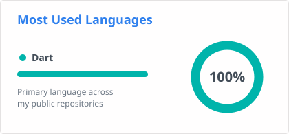

<h2>👨‍💻 About Me</h2>

Computer & Information Engineering graduate from **Mansoura University** (June 2026, Very Good). 
Mobile Application Developer building high-performance, cross-platform apps with **Flutter** and **Dart**, 
with a focus on clean, scalable code and a smooth user experience.

<h2>🛠️ Tech Stack</h2>

| Area | Technologies |
|:---:|:---:|
| 🏛️ **Architecture** | Clean Architecture · MVVM · SOLID |
| 🔄 **State Management** | BLoC / Cubit |
| 🌐 **Networking & DI** | RESTful APIs · Dio · GetIt |

<h2>📊 GitHub Stats</h2>

<h2>📫 Get in Touch</h2>

&nbsp;&nbsp;
&nbsp;&nbsp;

<h2>💻 Repositories</h2>

